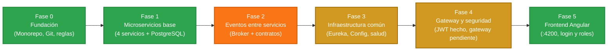
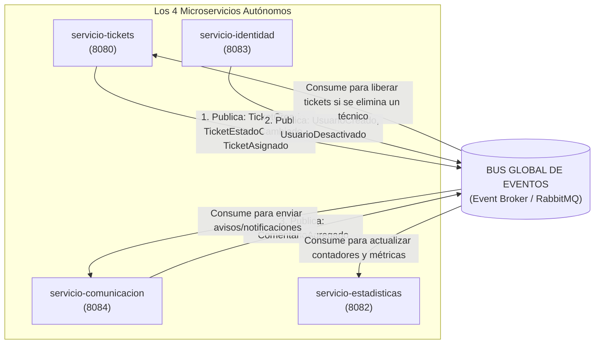

#  ARQUITECTURA MAESTRA Y REGLAS DE ORO — HELPDESK

> **DOCUMENTO OFICIAL DEL PROYECTO (GUÍA ÚNICA)**  
> Este documento unifica toda la arquitectura técnica, las reglas de desarrollo, el funcionamiento del orquestador, los contratos de datos y la planificación del API Gateway y Frontend. Todo compañero de equipo debe regirse por este estándar.

---

##  PROPÓSITO GENERAL Y ENFOQUE FUNCIONAL DE TI

El sistema **HelpDesk** es una **Plataforma Distribuida de Mesa de Ayuda de TI (IT Service Desk)** cuyo objetivo primordial es **centralizar, canalizar y resolver incidentes y requerimientos tecnológicos** de una organización (fallos de red, accesos, equipos o software).

###  Asignación Oficial de Desarrolladores por Componente:
| Desarrollador | Componente / Responsabilidad | Carpeta | Puerto App | Puerto BD | pgAdmin |
| :--- | :--- | :--- | :---: | :---: | :---: |
| **Ariel Martín Guerrero Sandoval** | **Servicio de Tickets** (Núcleo de incidentes) | `services/servicio-tickets` | `8080` | `5433` | `5050` |
| **Gabriel Emilio Ponce Salazar** | **Servicio de Comunicación** (Comentarios y avisos) | `services/servicio-comunicacion` | `8084` | `5435` | `5054` |
| **Miguel Anderson Chanchay** | **Servicio de Estadísticas** (Métricas y auditoría TI) | `services/servicio-estadisticas` | `8082` | `5436` | `5052` |
| **Dylan Miguel Vargas Onofa** | **Frontend SPA + API Gateway** (Entrada y UI Web) | `frontend` / `gateway` | `3000` / `8000` | N/A | N/A |
| **Anthony Marcel Orozco Junia** | **Servicio de Identidad** (Usuarios, roles y catalogo) | `services/servicio-identidad` | `8083` | `5434` | `5053` |

---
1. **Detección y Apertura:** Un empleado (`SOLICITANTE`) detecta una anomalía y registra un ticket en el sistema con un nivel de prioridad asignado.
2. **Triaje y Asignación:** El soporte técnico o administrador asigna el ticket a un especialista (`TECNICO`), moviendo el estado a `EN_PROGRESO`.
3. **Diagnóstico y Retroalimentación:** El técnico agrega notas técnicas o solicita más datos mediante el módulo de comunicación; el usuario recibe notificaciones de cada avance.
4. **Cierre y Solución:** El técnico marca el ticket como `RESUELTO`.
5. **Métricas de Calidad:** Se recalculan los contadores en tiempo real para evaluar tiempos de respuesta y carga de trabajo en el departamento de TI.

---

## 1.  LAS 5 REGLAS DE ORO INMUTABLES (OBLIGATORIAS)

Para que cualquier desarrollador pueda clonar el proyecto, agregar código y probar en su máquina sin que los microservicios de los demás colapsen, existen 5 reglas obligatorias:

> **REGLA CERO (prevalece sobre las demás): cada quien solo modifica su área.**
> El área de cada persona es su servicio **y su pestaña del frontend** (`frontend/src/app/<dominio>/`), no solo la
> carpeta del servicio: Ariel `tickets/`, Gabriel `comunicacion/`, Anthony `identidad/`, Miguel `dashboard/`.
> Dylan es dueño de `gateway/` y del resto de `frontend/`, salvo las pestañas de los demás. Los archivos
> compartidos (`docker-compose.yml`, `frontend/proxy.conf.json`, `frontend/src/environments/`,
> `frontend/src/app/services/`, `frontend/src/app/models/`, `.github/`, `docs/`) solo cambian en una rama
> `chore/<tema>` con un PR pequeño y aditivo aprobado por Miguel. Que no haya conflicto de Git no significa que el
> cambio sea seguro. Si tu funcionalidad necesita algo fuera de tu área, no lo hagas: avisa al dueño.
> Guía completa y cómo se hace cumplir: [docs/REGLAS_DE_ALCANCE.md](docs/REGLAS_DE_ALCANCE.md).

> **REGLA UNO (inmutable, igual de obligatoria que la anterior): el orden de trabajo es siempre el mismo.**
> Actualizar tu rama (`git merge origin/dev`), cambios y commits pequeños, push, Pull Request hacia `dev`, revisión
> de otra persona con los chequeos en verde, merge, y volver a actualizar. Nunca un PR hacia `main` (solo el
> release `dev` → `main` que decide el dueño), nunca fusionar sin revisión, y un PR que depende de otro no se abre
> hasta que ese otro esté en `dev`. Los agentes la cumplen igual que las personas. Pasos y comandos:
> [docs/FLUJO_DE_TRABAJO.md](docs/FLUJO_DE_TRABAJO.md).

1. **PROHIBIDO compartir Entidades (`@Entity`) entre servicios:**  
   Cada microservicio es dueño absoluto de sus tablas. Para vincular información de otro servicio (usuario, ticket, autor), usa **únicamente IDs numéricos primitivos** (`Long solicitanteId`, `Long ticketId`, `Long autorId`).  
    *Prohibido:* `@ManyToOne private Usuario usuario;` (acopla las bases de datos y tumba el proyecto si el compañero cambia su tabla).  
    *Correcto:* `private Long solicitanteId;` (desacoplado y 100% seguro).

2. **PROHIBIDO llamadas HTTP bloqueantes directas entre microservicios:**  
   Ningún microservicio llama por `RestTemplate` o `WebClient` directo a otro al crear, editar o cambiar estados. Si el servicio de tu compañero está apagado en local, tu código fallaría con error 500. La sincronía se hace mediante el **Bus de Eventos (Asíncrono)** o a través del **API Gateway**.

3. **PROHIBIDO alterar los puertos y nombres de base de datos asignados:**  
   Son contratos estáticos de red que deben mantenerse idénticos:
   - `servicio-tickets`: App **`8080`** | PostgreSQL **`5433`** (`tickets_db`)
   - `servicio-estadisticas`: App **`8082`** | PostgreSQL **`5436`** (`estadisticas_db`)
   - `servicio-identidad`: App **`8083`** | PostgreSQL **`5434`** (`identidad_db`)
   - `servicio-comunicacion`: App **`8084`** | PostgreSQL **`5435`** (`comunicacion_db`)
   - `eureka-server` (infraestructura): App **`8081`** | `config-server` (infraestructura): App **`8888`**
   - *API Gateway (Futuro):* Puerto **`8000`** | *Frontend Web (Futuro):* Puerto **`3000`**

4. **PROTOCOLO DE IDENTIFICACIÓN, ASIGNACIÓN HERMÉTICA Y PRIVILEGIOS DE DUEÑO:**  
   -  **Miguel Anderson Chanchay** (`@ANDERSOUNDZ` / `miguelchanchay`) es el **Dueño y Administrador del Repositorio**. Tiene **acceso irrestricto y total** a todos los microservicios, infraestructura, Docker y ramas para resolver bloqueos, administrar arquitectura y aprobar PRs.
   - Para cualquier otro desarrollador, el agente verificará: **nombre completo y usuario de GitHub conectado**.
   - Cada colaborador solo puede modificar su carpeta hermética y su rama:
     - **Ariel Martín Guerrero Sandoval**  Únicamente en `services/servicio-tickets/` (`feat/tickets`).
     - **Gabriel Emilio Ponce Salazar**  Únicamente en `services/servicio-comunicacion/` (`feat/comunicacion`).
     - **Dylan Miguel Vargas Onofa**  Únicamente en `frontend/` y `gateway/` (`feat/frontend`, `feat/gateway`).  
      - **Anthony Marcel Orozco Junia** ➔ Únicamente en `services/servicio-identidad/` (`feat/identidad`).
   *Regla inquebrantable:* Ningún colaborador puede tocar código ajeno ni hacer push directo a `dev` ni a `main`. Todo cambio requiere Pull Request firmado por el colaborador asignado y aprobado por Miguel Chanchay.

5. **NUNCA ejecutar comandos destructivos de Docker:**  
    `docker compose down -v` (Borra los volúmenes y las bases de datos).  
    `docker compose down` (Detiene los contenedores y **conserva intactos** los datos).

---

## 2. ️ ROADMAP DEL PROYECTO & ESTADO DE LOS PROCESOS



### Estado de cada Fase:
- [x] **Fase 0 (Completada):** monorepo, convenciones Git por integrante (`feat/<servicio>` → `dev` → `main`), cherry-pick, reglas de alcance con guardia automático en GitHub Actions y protección de ramas.
- [x] **Fase 1 (Completada y Operativa):** 4 microservicios con Spring Boot 4 y Spring Data JPA, una base PostgreSQL por servicio y una conjunta. **83 pruebas** pasando (identidad 28, tickets 14, comunicación 29, estadísticas 10, Eureka 1, Config 1).
- [ ] **Fase 2 (Siguiente):** bus de eventos entre servicios y módulo común de contratos (`helpdesk-common`). Hoy el aviso de cambio de estado se envía a mano.
- [ ] **Fase 3 (Parcial):** hecho: Eureka (`:8081`), Config Server (`:8888`) y `GET /actuator/health` con *healthchecks*. Falta: migraciones con Flyway.
- [ ] **Fase 4 (Parcial):** hecho: login con JWT, roles `SOLICITANTE` / `TECNICO` / `ADMINISTRADOR` y permisos en los 4 servicios, apagado por defecto (ver [docs/AUTENTICACION.md](docs/AUTENTICACION.md)). Falta: API Gateway en Spring Cloud Gateway (puerto `8000`) y que cada usuario vea solo *sus* tickets.
- [x] **Fase 5 (Completada):** frontend Angular 22 + Material en `:4200` con pantalla de login, pestañas y botones según el rol.

---

## 3.  EL ORQUESTADOR: MALLA DE EVENTOS GLOBAL ENTRE LOS 4 SERVICIOS

> **Estado: planificado (Fase 2).** Esta malla de eventos todavía no existe: hoy los servicios no se llaman entre sí y el aviso de cambio de estado se envía a mano con `POST /eventos/ticket-estado`.

Para que todos los servicios sincronicen su información sin acoplarse, se utiliza un **Bus de Eventos Asíncrono (RabbitMQ)**. Cuando ocurre una acción importante en un microservicio, este publica un evento al bus y los demás servicios reaccionan automáticamente:



### Matriz de Eventos Global:
| Evento | Emite | Reacciona / Consume | Efecto en el Sistema |
| :--- | :---: | :---: | :--- |
| **`TicketCreadoEvent`** | `tickets` | `comunicacion`, `estadisticas` | Envía notificación al solicitante y suma +1 al contador de tickets abiertos. |
| **`TicketEstadoCambiadoEvent`** | `tickets` | `comunicacion`, `estadisticas` | Notifica al usuario (*"Tu ticket se resolvió"*) y actualiza las gráficas en tiempo real. |
| **`TicketAsignadoEvent`** | `tickets` | `comunicacion` | Notifica al técnico asignado con su nueva tarea. |
| **`UsuarioCreadoEvent`** | `identidad` | `comunicacion`, `estadisticas` | Inicializa la bandeja del usuario y actualiza estadísticas por rol. |
| **`UsuarioDesactivadoEvent`** | `identidad` | `tickets`, `comunicacion` | Si se elimina un técnico, `tickets` libera sus tickets para reasignarlos. |
| **`ComentarioAgregadoEvent`** | `comunicacion` | `tickets`, `estadisticas` | Actualiza la última actividad del ticket y calcula tiempos de respuesta. |

---

## 4.  ESTANDARIZACIÓN DE DATOS (MÓDULO `helpdesk-common`)

> **Estado: planificado (Fase 2).** El módulo `helpdesk-common` todavía no se creó.

Para no duplicar clases ni compartir entidades de base de datos, se creará un módulo Java ligero con clases planas (`records` de Java, sin JPA):

```java
// Contrato de evento para el Bus
public record TicketEstadoCambiadoEvent(
    Long ticketId,
    String titulo,
    String estadoAnterior,
    String estadoNuevo,
    Long solicitanteId
) {}

// DTO estándar para exponer datos entre servicios o al Frontend
public record UsuarioResumenDTO(
    Long id,
    String nombre,
    String rol
) {}
```

---

## 5.  ESPECIFICACIÓN: API GATEWAY Y FRONTEND (DYLAN MIGUEL VARGAS ONOFA)

> **Desarrollador Responsable:** **Dylan Miguel Vargas Onofa**  
> **Ramas asignadas:** `feat/gateway`, `feat/frontend`  
> **Puertos:** Gateway (`8000`, pendiente) | Frontend Angular (`4200`, hecho)

### ‍ Para el Desarrollador (Dylan Miguel Vargas Onofa)
#### ¿Qué está hecho hasta ahora?
- Los 4 microservicios backend tienen endpoints REST funcionales en sus puertos (`:8080`, `:8083`, `:8084`, `:8082`), con login por roles (apagado por defecto).
- **El frontend Angular ya está hecho** (`frontend/`, puerto `4200`): pantalla de login, pestañas y botones según el rol, y las vistas de estadísticas, tickets, comunicación e identidad. Detalle en [docs/AUTENTICACION.md](docs/AUTENTICACION.md).
- **Eureka** (`:8081`) ya registra a los 4 servicios, lo que permitirá al gateway enrutar por nombre (`lb://servicio-tickets`).

#### ¿Qué debes revisar y qué sigue en tu roadmap?
1. **API Gateway (Spring Cloud Gateway en `:8000`) — pendiente:**
   - Centralizar todas las peticiones para que el frontend no tenga que conocer 4 puertos distintos.
   - Habilitar CORS globalmente para permitir peticiones desde `http://localhost:4200`.
   - Mapear las rutas limpias:
     - `/api/tickets/**`  `servicio-tickets:8080/tickets/**`
     - `/api/usuarios/**`  `servicio-identidad:8083/usuarios/**`
     - `/api/comentarios/**`  `servicio-comunicacion:8084/comentarios/**`
     - `/api/notificaciones/**`  `servicio-comunicacion:8084/notificaciones/**`
     - `/api/estadisticas/**`  `servicio-estadisticas:8082/resumen`
2. **Frontend SPA (Angular, ya hecho, en `:4200`):** se conecta hoy por rutas relativas (`/tickets`, `/usuarios`...) con el proxy de desarrollo; con el gateway pasará a `http://localhost:8000/api`. Vistas:
   - **Vista de Tickets (Ariel):** Lista de tickets, filtro por estado (`ABIERTO`, `EN_PROGRESO`, `RESUELTO`), formulario de creación y botón de asignación.
   - **Panel de Comunicación (Gabriel):** Sección de notas/comentarios dentro del detalle de un ticket y campana de notificaciones del usuario.
   - **Dashboard de Métricas (Miguel):** Tarjetas con contadores de tickets abiertos vs resueltos consumiendo `/api/estadisticas`.

---

### A. API Gateway (Puerto `8000`)
Punto de entrada único para el Frontend. Enruta de forma transparente:
- `/api/tickets/**`  `http://servicio-tickets:8080/tickets/**`
- `/api/usuarios/**`  `http://servicio-identidad:8083/usuarios/**`
- `/api/comentarios/**`  `http://servicio-comunicacion:8084/comentarios/**`
- `/api/notificaciones/**`  `http://servicio-comunicacion:8084/notificaciones/**`
- `/api/estadisticas/**`  `http://servicio-estadisticas:8082/resumen`

### B. Contratos TypeScript del Frontend
Los contratos reales están en [`frontend/src/app/models/helpdesk.model.ts`](frontend/src/app/models/helpdesk.model.ts). Los principales:
```typescript
export type Prioridad = 'BAJA' | 'MEDIA' | 'ALTA';
export type EstadoTicket = 'ABIERTO' | 'EN_PROGRESO' | 'RESUELTO';
export type Rol = 'SOLICITANTE' | 'TECNICO' | 'ADMINISTRADOR';

export interface Ticket {
  id?: number;
  titulo: string;
  descripcion?: string;
  prioridad: Prioridad;
  estado?: EstadoTicket;
  solicitanteId: number;
  tecnicoId?: number | null;
}

export interface Usuario {
  id?: number;
  nombre: string;
  rol: Rol;
  username?: string;   // usuario de acceso (opcional)
  clave?: string;      // solo se envía al crear o editar; el servidor nunca la devuelve
  activo?: boolean;
}

export interface Comentario {
  id?: number;
  ticketId: number;
  autorId: number;
  texto: string;
  autorNombre?: string | null;
  destinatarioId?: number | null;
}

export interface ResumenTickets {
  abiertos: number;
  enProgreso: number;
  resueltos: number;
  total: number;
}
```
El estado `CERRADO`, el rol `DOCENTE` y la prioridad `URGENTE` de versiones anteriores de este documento **no existen**.
- Tu app correrá en: `http://localhost:8080`
- Tu base PostgreSQL correrá en: `localhost:5433`
- Para apagar sin perder datos: `docker compose down`

### Modo 2: Levantar TODO el sistema integrado
Desde la raíz del proyecto para demostraciones o pruebas de integración:
```powershell
cd HelpDesk
docker compose up -d --build
```
- Levanta una sola base PostgreSQL (puerto `5432`) con las 4 bases inicializadas, los 4 microservicios, **Eureka** (`:8081`), **Config Server** (`:8888`) y pgAdmin (`:5055`).
- El frontend se levanta aparte: `cd frontend && npm install && npm start` (puerto `4200`).
- El login con roles viene **apagado por defecto**. Para encenderlo, copia `.env.example` como `.env`, completa `AUTH_ENABLED=true`, `JWT_SECRET` y la clave del administrador, y vuelve a ejecutar `docker compose up -d --build`. Guía completa: [docs/AUTENTICACION.md](docs/AUTENTICACION.md).
- Si quieres exponerlo en internet con un túnel de Cloudflare: [docs/TUNEL_CLOUDFLARE.md](docs/TUNEL_CLOUDFLARE.md) (enciende el login antes de compartir el enlace).
