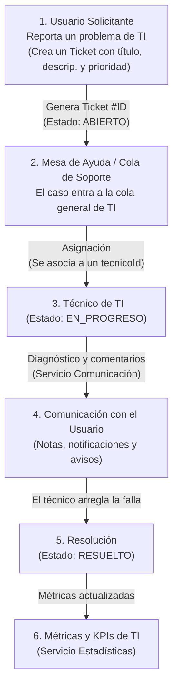
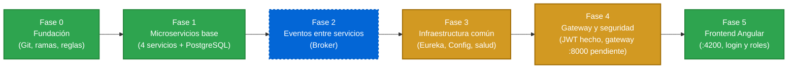

# HelpDesk: Plataforma Distribuida de Mesa de Ayuda de TI

Plataforma de **gestión de incidentes y requerimientos tecnológicos** construida como **microservicios distribuidos e independientes** con Spring Boot 4 y PostgreSQL. Incluye **login con roles (JWT)**, descubrimiento de servicios (Eureka), configuración centralizada y un **frontend Angular**; los eventos entre servicios y el API Gateway siguen pendientes.

>  **DOCUMENTO MAESTRO PARA DESARROLLADORES:**  
> Consulta la [**Guía Maestra y Reglas Inmutables (ORQUESTADOR_MAESTRO.md)**](ORQUESTADOR_MAESTRO.md) antes de escribir código para conocer las reglas que evitan que los microservicios colapsen entre sí.
>
> **Regla de oro:** cada quien solo modifica su área (su servicio y su pestaña del frontend). Detalle y cómo se hace cumplir en [docs/REGLAS_DE_ALCANCE.md](docs/REGLAS_DE_ALCANCE.md).
>
> **El orden de siempre** (actualizar, commits, push, PR, revisión, merge): [docs/FLUJO_DE_TRABAJO.md](docs/FLUJO_DE_TRABAJO.md).
>
> **Login con roles** (`SOLICITANTE`, `TECNICO`, `ADMINISTRADOR`): viene apagado por defecto. Cómo encenderlo, permisos y pantallas: [docs/AUTENTICACION.md](docs/AUTENTICACION.md).

---

##  Propósito y Enfoque del Proyecto

El objetivo principal de este sistema es **centralizar, rastrear y resolver solicitudes o fallas técnicas corporativas** (incidentes de hardware, software, accesos y redes) reportadas por usuarios, asignándolas a un técnico especialista y midiendo los tiempos de atención mediante un ciclo de vida formal y desacoplado.

###  Flujo Central del Negocio (Ciclo de Vida de TI)



###  Responsabilidades y Asignación de Desarrolladores

| Desarrollador | Microservicio / Módulo | Responsabilidad en la Mesa de Ayuda | Puertos |
|---|---|---|:---:|
| **Ariel Martín Guerrero Sandoval** | **`servicio-tickets`** | **Corazón del incidente:** Genera folios de tickets, máquina de estados (`ABIERTO`  `EN_PROGRESO`  `RESUELTO`) y asignación de técnicos. | App: `8080`<br>BD: `5433`<br>pgAdmin: `5050` |
| **Gabriel Emilio Ponce Salazar** | **`servicio-comunicacion`** | **Canal de soporte:** Registro de notas y comentarios sobre tickets, y notificaciones automáticas al usuario. | App: `8084`<br>BD: `5435`<br>pgAdmin: `5054` |
| **Miguel Anderson Chanchay** | **`servicio-estadisticas`** + infraestructura | **Auditoría y KPIs:** Métricas de tickets abiertos, en progreso y resueltos para el tablero gerencial. Dueño del repositorio y de la infraestructura (`eureka-server`, `config-server`). | App: `8082`<br>BD: `5436`<br>pgAdmin: `5052`<br>Eureka: `8081`<br>Config: `8888` |
| **Dylan Miguel Vargas Onofa** | **Frontend Web + API Gateway** | **Experiencia de Usuario y Enrutamiento:** Aplicación SPA en Angular (login y pestañas según el rol, `:4200`) y, pendiente, la puerta de enlace unificada (`:8000`). | SPA: `4200`<br>Gateway (pendiente): `8000` |
| **Anthony Marcel Orozco Junia** | **`servicio-identidad`** | **Control de Identidad:** Login (JWT) y catálogo de usuarios con roles `SOLICITANTE`, `TECNICO` y `ADMINISTRADOR`. | App: `8083`<br>BD: `5434`<br>pgAdmin: `5053` |

---

## ️ Roadmap del Proyecto & Estado Actual

Este roadmap describe el orden cronológico de los procesos: los completados, los parciales y los pendientes.



### Tabla de Seguimiento del Roadmap

| Fase | Proceso / Hito | Estado | Qué está levantado / Qué falta |
| :---: | :--- | :---: | :--- |
| **0** | **Fundación del Repositorio** |  **Completado** | Estructura en un solo repo Git, convenciones, plantillas de PR, workflow de cherry-pick. |
| **1** | **Microservicios independientes** | Completado | **4 microservicios** con Spring Boot y Spring Data JPA: `servicio-tickets` (8080), `servicio-identidad` (8083), `servicio-comunicacion` (8084) y `servicio-estadisticas` (8082).<br>• **Persistencia:** una base PostgreSQL por servicio (5433-5436) y una conjunta (5432).<br>• **Pruebas:** unitarias y de seguridad en cada servicio; Maven Wrapper incluido. |
| **2** | **Eventos entre servicios** | Pendiente | Bus de eventos / broker que interconecte a los 4 servicios sin llamadas HTTP bloqueantes. Hoy el aviso de cambio de estado se envía a mano (ver [ORQUESTADOR_MAESTRO.md](ORQUESTADOR_MAESTRO.md)). |
| **3** | **Infraestructura común** | Parcial | **Hecho:** Eureka (`:8081`), Config Server (`:8888`) y `GET /actuator/health` con *healthchecks* en Docker. **Falta:** migraciones con Flyway. Ver [Infraestructura](#infraestructura-eureka-y-config-server). |
| **4** | **Gateway y seguridad** | Parcial | **Hecho:** login con JWT, roles `SOLICITANTE` / `TECNICO` / `ADMINISTRADOR` y permisos en los 4 servicios (apagado por defecto). **Falta:** API Gateway en el puerto `8000` y que cada usuario vea solo *sus* tickets. Ver [docs/AUTENTICACION.md](docs/AUTENTICACION.md). |
| **5** | **Frontend SPA** | Completado | Aplicación **Angular 22 + Material** en `:4200`: pantalla de login, pestañas y botones según el rol, y las 4 vistas (estadísticas, tickets, comunicación e identidad). |

---

## Inicio rapido

Esta seccion esta escrita para que una persona, **o un agente de IA que la lea**, pueda levantar un servicio
sin conocer el proyecto, comprobar que funciona y explicarselo a quien lo va a usar. Todos los comandos se
probaron con los cuatro servicios.

### Reglas para el agente

1. Si no te dijeron **que servicio** levantar, preguntalo (tabla del paso 0).
2. Usa solo los comandos de esta seccion, desde la carpeta indicada. No modifiques codigo ni archivos de
   otros servicios para lograr que arranque.
3. **Nunca** ejecutes `docker compose down -v`, `docker volume rm` ni `docker system prune` sin preguntar:
   borran los datos de la base.
4. No hagas commit, push ni cambies de rama salvo que te lo pidan.
5. Si algo falla, lee los registros (`docker compose logs`), consulta [Si algo falla](#si-algo-falla) e
   informa el error **real**. No inventes resultados.
6. Las claves de las bases son de desarrollo y estan a la vista; no las cambies.
7. En Windows ejecuta los comandos en **Git Bash** o WSL. En PowerShell, `curl` es otro comando: usa `curl.exe`.

### Paso 0: elegir el servicio

| Servicio | Carpeta | App | PostgreSQL | PGAdmin | Base de datos | Comprobacion | Tablas |
|---|---|---|---|---|---|---|---|
| `servicio-tickets` | `services/servicio-tickets` | 8080 | 5433 | [5050](http://localhost:5050) | `tickets_db` | `GET /tickets` | `tickets` |
| `servicio-identidad` | `services/servicio-identidad` | 8083 | 5434 | [5053](http://localhost:5053) | `identidad_db` | `GET /usuarios` | `usuarios` |
| `servicio-comunicacion` | `services/servicio-comunicacion` | 8084 | 5435 | [5054](http://localhost:5054) | `comunicacion_db` | `GET /comentarios` | `comentarios`, `notificaciones` |
| `servicio-estadisticas` | `services/servicio-estadisticas` | 8082 | 5436 | [5052](http://localhost:5052) | `estadisticas_db` | `GET /resumen` | `contadores_estado` |

El usuario y la clave de cada base son el nombre corto del servicio (`tickets`/`tickets`,
`identidad`/`identidad`, `comunicacion`/`comunicacion`, `estadisticas`/`estadisticas`).
Las credenciales de acceso para **pgAdmin** en todos los servicios son:
- **Email:** `admin@admin.com`
- **Password:** `admin`
- **Host de la BD al conectar en pgAdmin:** `db` (puerto `5432` interno de la red Docker)

### Paso 1: comprobar los requisitos

```bash
docker --version          # debe mostrar una version
docker compose version    # debe mostrar una version
docker info               # no debe fallar con "Cannot connect to the Docker daemon"
```

Si `docker info` falla, Docker no esta abierto: abre Docker Desktop (o `sudo systemctl start docker` en Linux)
y espera a que diga que esta corriendo. No hace falta instalar Java, Maven ni PostgreSQL.

### Paso 2: levantar el servicio y su base

```bash
cd services/servicio-tickets          # la carpeta del paso 0
docker compose up -d --build
```

La primera vez tarda de 2 a 5 minutos (descarga imagenes y compila; necesita internet); las siguientes, menos de
uno. Comprueba con `docker compose ps`: deben aparecer **dos contenedores** en estado *running*, `...-db-1`
(PostgreSQL, *healthy*) y `...-app-1` (la aplicacion).

### Paso 3: esperar a que responda

Cambia el puerto y la ruta por los de tu servicio (paso 0):

```bash
until [ "$(curl -s -o /dev/null -w '%{http_code}' localhost:8080/tickets)" = "200" ]; do sleep 2; done; echo listo
```

Debe imprimir `listo` en menos de 1 minuto. Si pasan 2 minutos, ve a [Si algo falla](#si-algo-falla).

### Paso 4: prueba de humo (todas deben dar la respuesta indicada)

```bash
# servicio-tickets (8080)
curl -s localhost:8080/tickets                                            # []
curl -s -X POST localhost:8080/tickets -H 'Content-Type: application/json' \
  -d '{"titulo":"Wifi caido","prioridad":"ALTA","solicitanteId":3}'       # {"id":1,"estado":"ABIERTO",...}

# servicio-identidad (8083)
curl -s localhost:8083/usuarios                                           # []
curl -s -X POST localhost:8083/usuarios -H 'Content-Type: application/json' \
  -d '{"nombre":"Ana","rol":"SOLICITANTE"}'                                # {"id":1,"nombre":"Ana","rol":"SOLICITANTE"}

# servicio-comunicacion (8084)
curl -s localhost:8084/comentarios                                        # []
curl -s -X POST localhost:8084/comentarios -H 'Content-Type: application/json' \
  -d '{"ticketId":1,"autorId":9,"texto":"Ya lo revise"}'                  # {"id":1,"ticketId":1,"autorId":9,...}

# servicio-estadisticas (8082)
curl -s localhost:8082/resumen                                            # {"abiertos":0,"enProgreso":0,"resueltos":0}
curl -s -X POST localhost:8082/eventos/ticket-estado -H 'Content-Type: application/json' \
  -d '{"estadoAnterior":null,"estadoNuevo":"ABIERTO"}'                    # {"abiertos":1,"enProgreso":0,"resueltos":0}
```

### Paso 5: ver que los datos estan en la base

Desde la carpeta del servicio (`-T` evita pedir una terminal interactiva):

```bash
docker compose exec -T db psql -U tickets -d tickets_db -c "select * from tickets"
```

Cambia usuario, base y tabla segun el paso 0 (por ejemplo `-U identidad -d identidad_db ... from usuarios`).
Debe mostrar la fila creada en el paso 4. Reinicia con `docker compose restart` y vuelve a consultar: la fila
**sigue ahi**, porque los datos viven en un volumen de Docker.

### Paso 6: que explicarle a la persona

El agente debe contar, con sus propias palabras y usando los datos reales del paso que acaba de ejecutar:

1. **Que es el servicio:** su responsabilidad (columna *Responsabilidad* de la tabla de
   [Servicios](#servicios)) y su entidad principal (tabla de [Entidades](#entidades-y-contrato-entre-servicios)).
2. **Que quedo corriendo:** dos contenedores, la aplicacion (puerto del paso 0) y su PostgreSQL propio. Ningun
   otro servicio hace falta para trabajar.
3. **Que acaba de pasar:** la prueba de humo creo un registro y se vio en la tabla de la base.
4. **Donde esta el codigo:** `src/main/java/com/helpdesk/<dominio>/` con `model/` (entidades = tablas),
   `repository/` (acceso a la base), `service/` (la logica) y `controller/` (los endpoints).
5. **Como probarlo con Postman:** endpoints y JSON de [Probar con Postman](#probar-con-postman).
6. **Como cambiar codigo:** editar, luego `docker compose up -d --build app` y repetir la prueba.
7. **Reglas del equipo:** cada persona tiene **una sola rama creada desde `dev`** (`feat/<servicio>`, por ejemplo
   `feat/tickets`) y desarrolla ahi; trae a diario lo de `dev` con `git merge origin/dev`; abre PR hacia `dev`
   con *merge commit*, y `dev` pasa a `main` cuando el equipo lo decide. No se tocan otros servicios y se
   respeta el contrato (puertos, rutas y el aviso de cambio de estado). El cherry-pick (workflow de GitHub
   Actions) se usa solo para copiar un commit suelto. Detalle en [Flujo de trabajo del equipo](#flujo-de-trabajo-del-equipo)
   y [CONTRIBUTING.md](CONTRIBUTING.md).
8. **Limites actuales, sin adornos:** los servicios todavia **no se llaman entre si** (el aviso de cambio de
   estado se envia a mano), el login con roles viene **apagado por defecto** (ver [docs/AUTENTICACION.md](docs/AUTENTICACION.md)) y las claves son de desarrollo.

### Paso 7: apagar

```bash
docker compose down        # apaga y CONSERVA los datos
```

`docker compose down -v` apaga y **borra los datos**: solo si la persona lo pide expresamente.

### Si algo falla

| Sintoma | Causa probable | Que hacer |
|---|---|---|
| `Cannot connect to the Docker daemon` | Docker esta apagado | Abrir Docker Desktop, esperar a que este corriendo y repetir |
| `no configuration file provided: not found` | No estas en la carpeta del servicio | `cd services/<carpeta>` (paso 0) |
| `port is already allocated` o `address already in use` (8080, 8082, 8083, 8084 o 5433 a 5436) | Otro servicio, o el modo "todos juntos" (opcion 3), ya usa ese puerto | `docker ps` para ver quien; apagarlo con `docker compose down` en la carpeta donde se levanto (o en la raiz si fue la opcion 3). Si no es Docker, cerrar el programa que usa el puerto |
| `curl` sin respuesta o `Connection refused` tras 2 minutos | La aplicacion no arranco | `docker compose logs app` y leer las ultimas lineas |
| En los registros: `password authentication failed` | La base se creo antes con otra clave | Preguntar a la persona; solo con su permiso, `docker compose down -v` y volver a levantar (borra los datos locales) |
| La app se reinicia o sale con `Exited (137)` | Docker se quedo sin memoria | Dar al menos 2 GB a Docker o apagar otros contenedores (`docker ps`) |
| El build falla con `Could not transfer` o `timeout` | Sin internet o red bloqueada | Reintentar con conexion; el primer build la necesita |
| Cambie el codigo y no se nota | La imagen no se reconstruyo | `docker compose up -d --build app` |
| `400 Bad Request` en una prueba | JSON invalido o falta un campo obligatorio | Leer el campo `message` de la respuesta |
| En PowerShell, `curl` pide parametros raros | Ahi `curl` es otro comando | Usar Git Bash o `curl.exe` |

Para trabajar con **todos los servicios juntos** o con solo la base, mira [Levantar el proyecto](#levantar-el-proyecto).

## Tabla de contenido

- [Inicio rapido](#inicio-rapido)
- [Stack](#stack)
- [Arquitectura general](#arquitectura-general)
- [Arquitectura de cada servicio](#arquitectura-de-cada-servicio)
- [Organizacion de carpetas](#organizacion-de-carpetas)
- [Levantar el proyecto](#levantar-el-proyecto)
- [Probar con Postman](#probar-con-postman)
- [Datos y comunicacion entre servicios](#datos-y-comunicacion-entre-servicios)
- [Entorno de desarrollo (Windows, macOS, Linux)](#entorno-de-desarrollo-windows-macos-linux)
- [Flujo de trabajo del equipo](#flujo-de-trabajo-del-equipo)
- [Hoja de ruta](#hoja-de-ruta)

## Stack

| Capa | Tecnologia | Notas |
|---|---|---|
| Lenguaje | Java 21 | Compila para Java 21; funciona igual con un JDK local 21 o 25 |
| Framework | Spring Boot 4.1 + Spring Cloud 2025.1 | Eureka (descubrimiento) y Config Server |
| Seguridad | Spring Security + JWT (HS256) | Roles `SOLICITANTE`, `TECNICO`, `ADMINISTRADOR`; apagada por defecto |
| Frontend | Angular 22 + Material | SPA en el puerto 4200 con login y pestañas por rol |
| Build | Maven (multi-modulo) | POM padre en la raiz *(planificado)* |
| Base de datos | PostgreSQL 17 + Spring Data JPA | Una base por servicio. Las tablas se crean solas (`ddl-auto=update`); migraciones con Flyway *(planificado)* |
| Contenedores | Docker + Docker Compose | Entorno unico para el equipo; un `docker-compose.yml` por servicio y otro en la raiz |
| CI | GitHub Actions | Guardia de alcance en cada PR y cherry-pick. Todavia no ejecuta los tests *(planificado)* |

## Arquitectura general

Cada servicio es **independiente**: su propio codigo, su propia base de datos, su propia imagen
Docker y su propio ciclo de despliegue. Viven juntos en un monorepo solo para facilitar la
coordinacion del equipo.

```
        Navegador: frontend Angular :4200 (login con roles)
                         |
       proxy de desarrollo hoy  /  API Gateway :8000 (pendiente)
                         |
        +-------------+--+-----------+--------------+
        v             v              v              v
  +-----------+ +-----------+ +--------------+ +---------------+
  |  servicio | |  servicio | |   servicio   | |    servicio   |
  |  tickets  | | identidad | | estadisticas | | comunicacion  |
  |   :8080   | |   :8083   | |    :8082     | |     :8084     |
  +-----+-----+ +-----+-----+ +------+-------+ +-------+-------+
        |             |              |                 |
        v             v              v                 v
   tickets_db   identidad_db   estadisticas_db   comunicacion_db

   Eureka :8081 (registro de servicios)      Config Server :8888 (configuracion)
   identidad emite el token (JWT); los demas servicios lo validan solos, sin llamarla
```

### Servicios

| Servicio | Responsabilidad | Puerto local | Estado | Responsable |
|---|---|---|---|---|
| `servicio-tickets` | Nucleo: crear, asignar, resolver, reabrir, editar y eliminar tickets; prioridad y estados (falta: categoria e historial de cambios) | 8080 | Operativo, con permisos por rol | Ariel Martin Guerrero Sandoval |
| `servicio-estadisticas` | Contadores por estado (falta: categoria, prioridad, tiempo promedio, carga de tecnicos) | 8082 | Operativo, con permisos por rol | Miguel Anderson Chanchay |
| `servicio-identidad` | Usuarios, roles y login (emite el JWT) | 8083 | Operativo | Anthony Marcel Orozco Junia |
| `servicio-comunicacion` | Comentarios con adjuntos, notificaciones y encuestas de satisfaccion (CSAT) | 8084 | Operativo, con permisos por rol | Gabriel Emilio Ponce Salazar |
| `eureka-server` | Infraestructura: descubrimiento de servicios | 8081 | Operativo | Miguel Anderson Chanchay |
| `config-server` | Infraestructura: configuracion centralizada | 8888 | Operativo | Miguel Anderson Chanchay |

Quien es dueno de que dato (para no pisarse):

- **tickets** guarda el `id` del usuario, nunca una copia de sus datos.
- **comunicacion** guarda cada comentario con el `ticketId`; no toca la tabla de tickets.
- **estadisticas** no lee la base de datos de otro servicio: recibe el aviso de cambio de estado (hoy enviado a
  mano) y guarda sus propios contadores en su base.
- **identidad** es el unico que conoce credenciales y roles.

### Infraestructura (Eureka y Config Server)

Dos modulos de apoyo, tomados del proyecto de ejemplo `smart-parking` (misma estructura y configuracion, sin su
logica de negocio). Viven junto a los servicios, en `services/`.

| Modulo | Para que sirve | Puerto | Panel o prueba |
|---|---|---|---|
| `eureka-server` | Descubrimiento: cada servicio se registra con su nombre (`servicio-tickets`...) y se encuentra por nombre, no por puerto | **8081** | http://localhost:8081 |
| `config-server` | Configuracion centralizada: entrega propiedades desde `config-repo/` (modo `native`) | **8888** | `curl localhost:8888/servicio-tickets/default` |

- **Son opcionales para trabajar.** Cada servicio los trae **apagados por defecto** (`EUREKA_ENABLED` y
  `CONFIG_ENABLED` en `false`), asi que quien levanta su servicio solo (opciones 1 y 2) no necesita nada mas.
  El `docker-compose.yml` de la raiz los enciende y levanta ambos servidores (opcion 3).
- El puerto `8080` del ejemplo es de `servicio-tickets`, por eso el Config Server usa el `8888`.
- **No cambian las reglas del contrato:** los servicios siguen refiriendose solo por id y no se llaman entre si
  por HTTP; Eureka sirve para que un gateway los encuentre, no para que se hablen.
- **El repositorio es publico: nada de contrasenas ni claves en `config-repo/`.** Los secretos van por variables de entorno.
- Si un servicio tiene su propio `src/test/resources/application.properties` (hoy solo `servicio-tickets`), ese archivo
  reemplaza al principal en las pruebas: debe llevar `eureka.client.enabled=false` y `spring.cloud.config.enabled=false`.

### Entidades y contrato entre servicios

Entidades minimas, una clase por concepto (en la carpeta `model/` de cada servicio):

| Servicio | Entidad | Campos |
|---|---|---|
| identidad | `Usuario` | `id`, `nombre`, `rol` (`SOLICITANTE`, `TECNICO`, `ADMINISTRADOR`), `username`, clave cifrada (nunca se devuelve), `activo` |
| tickets | `Ticket` | `id`, `titulo`, `descripcion`, `prioridad`, `estado`, `solicitanteId`, `tecnicoId` |
| comunicacion | `Comentario` | `id`, `ticketId`, `autorId`, `texto` |
| comunicacion | `Notificacion` | `id`, `usuarioId`, `mensaje`, `leida` |
| comunicacion | `Adjunto` | `id`, `comentarioId`, `nombreOriginal`, `contentType`, `tamanoBytes` (png, jpg o pdf; hasta 3 por comentario y 5 MB) |
| comunicacion | `EncuestaSatisfaccion` | `ticketId`, `solicitanteId`, `puntuacion` (1 a 5), `comentario`; se crea al resolver un ticket |
| estadisticas | `ResumenTickets` | `abiertos`, `enProgreso`, `resueltos` (se calcula, no se guarda) |

Estados del ticket: `ABIERTO` -> `EN_PROGRESO` (al asignarlo) -> `RESUELTO`.

**Reglas para que se entiendan sin depender unos de otros:**

1. **Referencias solo por id.** Se guarda `ticketId`, `usuarioId`, `tecnicoId`; nunca una copia del dato ajeno.
2. **Cada servicio tiene su propia clase** para lo que lee de otro. Nada de librerias de dominio compartidas.
3. **Los estados viajan como texto** (`"RESUELTO"`). Quien lee ignora lo que no conoce, asi agregar un
   estado no rompe a los demas.
4. **El camino principal no llama a otros servicios.** Crear un ticket o un comentario solo usa la base
   de datos propia: si otro servicio cae, este sigue trabajando.
5. **Errores en formato `ProblemDetail`** (404, 400, 409) en todos los servicios.

**Evento oficial:** cuando un ticket cambia de estado, servicio-tickets lo anuncia con este formato.

```json
{ "ticketId": 7, "estadoAnterior": "ABIERTO", "estadoNuevo": "RESUELTO",
  "solicitanteId": 3, "fecha": "2026-10-24T10:15:00Z" }
```

`servicio-comunicacion` lo usa para avisar al solicitante y `servicio-estadisticas` para sus contadores;
cada uno lo lee con su propia clase `TicketEstadoCambiado` y lo recibe en `POST /eventos/ticket-estado`.
**`servicio-tickets` todavia no lo envia solo**: por ahora lo simulas tu desde Postman (ver
[Probar con Postman](#probar-con-postman)). Falta decidir como se envia de verdad (broker o llamada HTTP
con tiempo limite).

Principios:

1. **Un servicio por contexto de negocio** (tickets, identidad, estadisticas, comunicacion).
2. **Base de datos propia por servicio.** Nadie lee la tabla de otro servicio; se pide por API.
3. **Sin codigo de dominio compartido.** Compartirlo acopla los servicios y obliga a desplegarlos juntos.
4. **Sin gateway por ahora.** Se agregara cuando haya mas de un servicio expuesto; la estructura ya le deja sitio.

## Arquitectura de cada servicio

Cada servicio es lo mas simple posible, igual que `espacios-service`: sin capas extra.

```
com.helpdesk.tickets
├─ ServicioTicketsApplication.java    Arranque de Spring Boot
├─ model/                            Entidades (tablas): Ticket, Prioridad, EstadoTicket
├─ repository/                       TicketRepository: guarda y consulta en PostgreSQL
├─ service/                          TicketService: la logica
└─ controller/                       TicketController: recibe la peticion y llama al servicio
```

- **`model/`:** las entidades. Son clases simples (campos, constructor vacio y getters/setters) que a la vez
  son la tabla en PostgreSQL y el JSON de Postman.
- **`repository/`:** una interfaz vacia que extiende `JpaRepository`; Spring genera el acceso a la base.
- **`service/`:** la logica. Valida lo basico y responde 400 / 404 / 409 con el motivo del error.
- **`controller/`:** los endpoints. No tiene logica, solo traduce HTTP al servicio.
- **Entre servicios:** referencias solo por id y ninguna llamada a otro servicio al crear algo, para que si
  uno cae los demas sigan trabajando.

**Por que tan simple:** el objetivo ahora es que todo el equipo pueda levantar el servicio y probarlo con
Postman. Cuando un servicio crezca (reglas de negocio, muchos endpoints) se separa en capas,
por ejemplo `domain` / `application` / `infrastructure`, sin cambiar la API ni a los demas servicios
(decision de diseno del proyecto).

## Organizacion de carpetas

```
helpdesk/
├─ README.md                      Este documento
├─ CONTRIBUTING.md                Ramas, commits, PR, cherry-pick, multiplataforma
├─ ORQUESTADOR_MAESTRO.md         Arquitectura y reglas inmutables
├─ .env.example                   Plantilla de variables (JWT_SECRET, administrador); el .env real NO se versiona
├─ .gitignore                     Ignora target/, .env, datos locales, IDEs
├─ .gitattributes                 Fuerza LF: mismo resultado en Windows, Mac y Linux
├─ .editorconfig                  Indentacion y charset iguales en cualquier IDE
├─ .github/
│  ├─ CODEOWNERS                  Quien revisa cada carpeta
│  ├─ pull_request_template.md    Plantilla de PR
│  └─ workflows/
│     ├─ guardia-de-alcance.yml   Rechaza PR que salgan del area de su rama o con titulo sin formato
│     └─ cherry-pick.yml          Cherry-pick automatizado hacia otra rama
├─ docker-compose.yml             Levanta TODO junto: 4 servicios, Eureka, Config Server, PostgreSQL y pgAdmin
├─ docker/postgres/               Script que crea las 4 bases y sus usuarios
├─ docs/                          Guias: autenticacion, flujo, reglas de alcance, E2E, tunel, Postman
├─ frontend/                      Aplicacion Angular (puerto 4200)
├─ gateway/                       API Gateway (pendiente, puerto 8000)
└─ services/                      Un subdirectorio por microservicio (cada uno independiente)
   ├─ servicio-tickets/           App en el puerto 8080
   ├─ servicio-identidad/         App en el puerto 8083
   ├─ servicio-comunicacion/      App en el puerto 8084
   ├─ servicio-estadisticas/      App en el puerto 8082
   ├─ eureka-server/              Infraestructura: descubrimiento, puerto 8081
   └─ config-server/              Infraestructura: configuracion, puerto 8888
```

Dentro de cada servicio:

```
<servicio>/
├─ pom.xml                        Proyecto Maven propio
├─ Dockerfile                     Imagen del servicio (JRE ligero, memoria acotada)
├─ docker-compose.yml             Levanta SOLO este servicio con SU PostgreSQL
└─ src/
   ├─ main/java/com/helpdesk/<nombre>/
   │  ├─ Servicio<Nombre>Application.java
   │  ├─ model/                   Entidades (tablas)
   │  ├─ repository/              Acceso a la base de datos
   │  ├─ service/                 Logica
   │  └─ controller/              Endpoints
   ├─ main/resources/application.properties    Nombre, puerto y conexion a la base
   └─ test/java/                  Tests del servicio (sin base de datos)
```

Pendiente *(planificado)*: POM padre, `scripts/` y workflows de CI que ejecuten los tests (`ci.yml`, `docker.yml`). Hoy el CI solo corre el guardia de
alcance y el cherry-pick.

Convenciones de nombres:

- Carpetas y archivos en **minusculas con guiones**, **sin tildes ni enie** (`estadisticas`, no `estadísticas`):
  las tildes dan problemas de codificacion entre Windows, macOS y Linux.
- Servicios en espanol, nombrados `servicio-<dominio>` (`servicio-tickets`, `servicio-identidad`...).
- Paquete de Java: `com.helpdesk.<dominio>` (`com.helpdesk.identidad`); el nombre de la carpeta debe coincidir
  con la linea `package` de cada clase.
- Clase de arranque: `Servicio<Dominio>Application` (el sufijo `Application` es la convencion de Spring Boot).

## Levantar el proyecto

**Requisitos:** solo Docker (Docker Desktop en Windows y macOS; Docker Engine con el plugin Compose en Linux).
No hace falta instalar Java, Maven ni PostgreSQL. Dale a Docker al menos 2 GB de memoria.

Cada servicio tiene **su propia base de datos PostgreSQL**. Hay tres formas de trabajar, de la mas liviana
a la mas completa:

### Opcion 1: solo tu servicio, con su base (la recomendada para trabajar)

Cada quien levanta unicamente el suyo. Desde la carpeta de tu servicio:

```bash
cd services/servicio-tickets        # tu carpeta
docker compose up -d --build        # levanta TU servicio y SU PostgreSQL
```

| Servicio | App | PostgreSQL (desde tu equipo) | Base / usuario / clave |
|---|---|---|---|
| `servicio-tickets` | `localhost:8080` | `127.0.0.1:5433` | `tickets_db` / `tickets` / `tickets` |
| `servicio-identidad` | `localhost:8083` | `127.0.0.1:5434` | `identidad_db` / `identidad` / `identidad` |
| `servicio-comunicacion` | `localhost:8084` | `127.0.0.1:5435` | `comunicacion_db` / `comunicacion` / `comunicacion` |
| `servicio-estadisticas` | `localhost:8082` | `127.0.0.1:5436` | `estadisticas_db` / `estadisticas` / `estadisticas` |

Comandos utiles (siempre desde la carpeta del servicio):

```bash
docker compose logs -f app          # ver los mensajes de la aplicacion
docker compose up -d --build app    # recompilar y reiniciar solo la app despues de cambiar codigo
docker compose down                 # apagar (los datos se conservan)
docker compose down -v              # apagar y BORRAR los datos
```

Los datos **se conservan** entre reinicios gracias al volumen de PostgreSQL. Las claves de arriba son solo
para desarrollo local; la base solo escucha en `127.0.0.1`, nadie mas de la red puede entrar.

### Opcion 2: solo la base en Docker y la app desde tu editor (la mas ligera)

```bash
cd services/servicio-tickets
docker compose up -d db             # solo PostgreSQL (unos 30 MB)
```

Luego ejecutas la aplicacion desde tu IDE (requiere JDK 21) con `ServicioTicketsApplication`. Ya apunta por
defecto a la base de la tabla de arriba, no hay que configurar nada.

### Opcion 3: todos los servicios juntos (para integrar)

Desde la raiz del repositorio. Usa **una sola instancia de PostgreSQL con 4 bases separadas** (cada servicio
con su usuario, y ninguno puede entrar a la base de otro), lo que gasta menos que 4 instancias:

```bash
docker compose up -d --build                                  # los 4 servicios + Eureka + Config Server + PostgreSQL
docker compose up -d servicio-tickets servicio-comunicacion   # solo algunos (y la base, Eureka y Config Server)
docker compose down                                           # apagar (los datos se conservan)
docker compose down -v                                        # apagar y BORRAR los datos
```

No uses la opcion 3 junto con la 1 al mismo tiempo: comparten los puertos de las aplicaciones. Si cambias
`docker/postgres/crear-bases.sql`, recrea los datos con `down -v`.

### Consumo de recursos

Medido con `docker stats` justo despues de arrancar (con uso intenso sube algo):

| Modo | Contenedores | Memoria aprox. |
|---|---|---|
| Opcion 2: solo la base | 1 | 30 MB (mas tu editor) |
| Opcion 1: un servicio y su base | 2 | 200 MB |
| Opcion 3: un solo servicio desde la raiz | 2 | 180 MB |
| Opcion 3: los 4 servicios juntos | 5 | 740 MB |

Lo que se hizo para que sea liviano:

- Imagen final con JRE minimo (no Maven ni JDK) y usuario sin privilegios.
- Cada app limitada: `-Xmx200m`, recolector `SerialGC` y tope de 320 MB por contenedor.
- Cada servicio abre solo 3 conexiones a la base (`DB_CONEXIONES`), y PostgreSQL esta recortado
  (`shared_buffers` bajo, pocas conexiones).
- En modo conjunto, un solo PostgreSQL en lugar de cuatro.

Consejos: trabaja con la opcion 1 o 2 y levanta la 3 solo para integrar; apaga con `docker compose down`
cuando termines; en Windows/macOS limita la memoria de Docker Desktop (Ajustes > Resources).

### Como se coordina el equipo

- Cada persona trabaja y prueba **su servicio solo** (opcion 1 o 2), sin esperar a nadie.
- Lo unico que comparten es el **contrato**: puertos, rutas y el aviso de cambio de estado, escritos en este
  README. Mientras cada uno lo respete, las piezas encajan.
- Para **integrar**: `git pull origin dev` y opcion 3 en una maquina, y se recorre el guion de la seccion
  siguiente. Conviene hacerlo al final de cada semana.
- **Estado actual:** los servicios todavia no se llaman entre si; el aviso de cambio de estado se envia a mano
  con Postman *(Fase 2: eventos reales entre servicios, pendiente)*. El login con roles viene apagado por defecto.

## Probar con Postman

Con el servicio levantado (cualquiera de las opciones anteriores), estos son los endpoints:

| Servicio | Puerto | Metodo y ruta | Que hace |
|---|---|---|---|
| tickets | 8080 | `POST /tickets` | Crea un ticket (nace `ABIERTO`) |
| | | `GET /tickets`, `GET /tickets/{id}` | Lista / consulta |
| | | `PUT /tickets/{id}/asignar/{tecnicoId}` | Asigna un tecnico y pasa a `EN_PROGRESO` |
| | | `PUT /tickets/{id}/resolver` | Pasa a `RESUELTO` |
| | | `PUT /tickets/{id}/reabrir` | Vuelve a `EN_PROGRESO` (solo si estaba `RESUELTO`) |
| | | `PUT /tickets/{id}`, `DELETE /tickets/{id}` | Edita / elimina un ticket |
| identidad | 8083 | `POST /auth/login` | Devuelve el token (JWT); solo hace falta con el login encendido |
| | | `POST /usuarios`, `GET /usuarios`, `GET /usuarios/{id}` | Crea y consulta usuarios |
| | | `PUT /usuarios/{id}`, `DELETE /usuarios/{id}` | Edita / elimina (solo `ADMINISTRADOR` con el login encendido) |
| comunicacion | 8084 | `POST /comentarios`, `GET /comentarios?ticketId=1` | Comentarios de un ticket |
| | | `GET /notificaciones?usuarioId=3&leida=false` | Avisos de un usuario |
| | | `PUT /notificaciones/{id}/leida` | Marca un aviso como leido |
| | | `POST /eventos/ticket-estado` | Recibe el evento y crea el aviso |
| | | Adjuntos, encuestas (CSAT), contador de avisos y busqueda paginada de comentarios | Ver [`services/servicio-comunicacion/README.md`](services/servicio-comunicacion/README.md) |
| estadisticas | 8082 | `GET /resumen` | Abiertos / en progreso / resueltos |
| | | `POST /eventos/ticket-estado` | Recibe el evento y actualiza los contadores |

Con el login **encendido** (`AUTH_ENABLED=true`), primero haz `POST /auth/login` y envia el token en cada peticion como
`Authorization: Bearer <token>`. Las colecciones de `docs/postman/` ya traen una peticion *Login* que lo guarda y lo envia solas.
Con el login apagado (lo normal) no hace falta nada de eso.

Cuerpos JSON de ejemplo (en Postman: *Body > raw > JSON*):

```jsonc
// POST localhost:8080/tickets
{ "titulo": "Wifi caido", "descripcion": "Sala 2", "prioridad": "ALTA", "solicitanteId": 3 }

// POST localhost:8083/usuarios            (rol: SOLICITANTE | TECNICO | ADMINISTRADOR; username y clave son opcionales)
{ "nombre": "Ana", "rol": "SOLICITANTE", "username": "ana", "clave": "unaclave123" }

// POST localhost:8083/auth/login            (solo con el login encendido)
{ "username": "ana", "clave": "unaclave123" }

// POST localhost:8084/comentarios
{ "ticketId": 1, "autorId": 9, "texto": "Ya lo revise" }

// POST localhost:8084/eventos/ticket-estado   y   POST localhost:8082/eventos/ticket-estado
{ "ticketId": 1, "estadoAnterior": "EN_PROGRESO", "estadoNuevo": "RESUELTO", "solicitanteId": 3 }
```

Para ver la comunicacion entre servicios: crea un ticket, asignalo y resuelvelo en tickets; luego envia el
mismo evento a comunicacion (aparece un aviso para el solicitante) y a estadisticas (cambia el resumen).

## Datos y comunicacion entre servicios

- **Base de datos:** PostgreSQL, **una base por servicio**. Las tablas se crean solas al arrancar
  (`ddl-auto=update`), suficiente para el prototipo; el siguiente paso son migraciones versionadas con Flyway
  *(planificado)*. Las claves de las bases son de desarrollo; la conexion se puede cambiar con las variables
  `DB_URL`, `DB_USUARIO`, `DB_CLAVE` y `DB_CONEXIONES`. El servicio de tickets usa H2 en memoria solo en su
  test de arranque.
- **Referencias entre servicios:** solo por id (`solicitanteId`, `ticketId`...), sin llave foranea, porque la
  tabla referenciada esta en la base de otro servicio.
- **Comunicacion:** hoy no hay llamadas entre servicios: el aviso de cambio de estado se envia a mano. Cuando haga falta desacoplar (por ejemplo,
  notificar al crear un ticket), se agregara mensajeria por eventos (Fase 2).
- **Salud:** cada servicio expone `GET /actuator/health` (solo ese endpoint, sin detalles). `docker-compose.yml`
  lo usa como *healthcheck* y Eureka lo usa para reflejar la salud real (`docker compose ps` muestra `healthy`).

## Entorno de desarrollo (Windows, macOS, Linux)

El equipo usa los tres sistemas operativos. Para que el resultado sea identico en todos:

- **Docker es el entorno comun.** Se compila, prueba y ejecuta dentro de contenedores:
  no hace falta instalar Java ni Maven en tu maquina.
- `.gitattributes` fuerza fin de linea LF, y `.editorconfig` unifica el formato.
- Las imagenes base son multi-arquitectura, asi que funcionan en Apple Silicon (arm64) y en x86.
- Los scripts son `bash`; en Windows se corren con Git Bash o WSL2.

Requisitos y detalles por sistema: [CONTRIBUTING.md, seccion 5](CONTRIBUTING.md#5-trabajar-en-windows-macos-y-linux).

## Flujo de trabajo del equipo

Somos 4 personas (Grupo 4), cada una con **un servicio** y **una sola rama**:

```
feat/tickets ───────┐
feat/identidad ─────┤
feat/comunicacion ──┼──► dev ──────────► main
feat/estadisticas ──┘   (integracion)    (estable)

  cada flecha es un Pull Request con "Create a merge commit"
```

1. **Crea tu rama una sola vez, desde `dev`** (`feat/tickets`, `feat/identidad`, `feat/comunicacion` o
   `feat/estadisticas`) y desarrolla ahi todo lo de tu servicio. No hay una rama por tarea y no se borra.
2. **Cada dia** trae lo de los demas a tu rama con `git merge origin/dev`. Los conflictos se resuelven **en tu
   rama**, nunca en `dev`. No uses `rebase` ni `push --force`.
3. **Cuando una parte este lista**, abre un PR de tu rama **hacia `dev`** y fusionalo con *Create a merge commit*
   (no *Squash*: con una rama larga el squash provoca conflictos repetidos). Sigues en la misma rama.
4. **`dev` pasa a `main`** con otro PR, cuando el equipo lo decide (por ejemplo, al final de cada semana, tras
   levantar todo junto y probarlo). Nadie empuja directo a `dev` ni a `main`.
5. **Para no chocar:** cada quien edita solo la carpeta de su servicio; los archivos compartidos (README,
   `docker-compose.yml` de la raiz, `.github/`, `docs/`) se cambian en una rama corta `chore/<tema>` con un PR
   pequeno; y se respeta el contrato (puertos, rutas y el aviso de cambio de estado).
6. **Cherry-pick:** copia **un commit concreto** a otra rama sin traer el resto. Sirve para llevar una correccion
   urgente a `main` sin publicar todo `dev`, para tomar un commit de un companero antes de que llegue a `dev`, o
   para rescatar un commit hecho en la rama equivocada. Se hace con el workflow de GitHub Actions
   *Cherry-pick a otra rama* (abre un PR; nunca empuja directo). No se usa para integrar trabajo normal.

Los commits siguen [Conventional Commits](https://www.conventionalcommits.org/es/) (`feat(tickets): ...`).
Todo el detalle, los comandos y las reglas estan en [CONTRIBUTING.md](CONTRIBUTING.md).

##  Hoja de ruta detallada

- [x] **Fase 0: Fundación:** repositorio, monorepo, convenciones de Git, cherry-pick, reglas de alcance con guardia automático y protección de ramas.
- [x] **Fase 1: Microservicios base:** cuatro microservicios (`tickets`, `identidad`, `comunicacion`, `estadisticas`) con capas simples, PostgreSQL independiente por servicio y conjunto, y Maven Wrappers integrados.
- [ ] **Fase 2: Orquestación & Sincronización Global:** bus de eventos / broker asíncrono para interconectar los 4 microservicios sin bloqueos ni caídas en cascada (ver [ORQUESTADOR_MAESTRO.md](ORQUESTADOR_MAESTRO.md)).
- [ ] **Fase 3: Infraestructura común** *(parcial)*: [x] Eureka y Config Server, [x] `GET /actuator/health` y *healthchecks*, [ ] migraciones con Flyway.
- [ ] **Fase 4: API Gateway y Seguridad** *(parcial)*: [x] login con JWT y roles `SOLICITANTE` / `TECNICO` / `ADMINISTRADOR` ([docs/AUTENTICACION.md](docs/AUTENTICACION.md)), [ ] API Gateway en el puerto `8000`, [ ] que cada usuario vea solo *sus* tickets.
- [x] **Fase 5: Frontend SPA:** aplicación Angular 22 + Material en `:4200` con login, pestañas y botones según el rol, y las vistas de estadísticas, tickets, comunicación e identidad.
