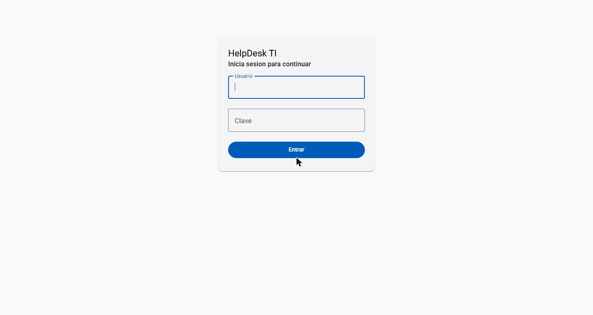
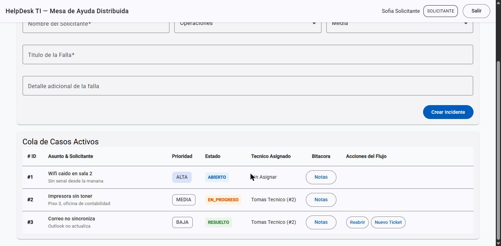
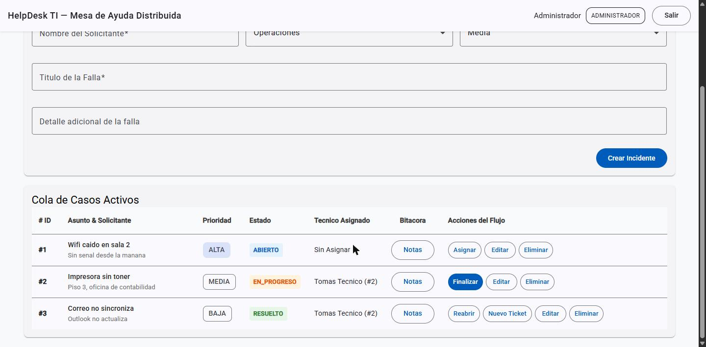

# Autenticacion y roles

HelpDesk tiene login con roles. **Viene apagado por defecto**: con `AUTH_ENABLED=false` todo funciona como siempre, sin
token, y cada persona puede levantar su servicio sola. Esta guia explica como encenderlo, que ve cada rol y que hacer
si algo falla.

## Como funciona

```
 1. login       POST /auth/login  {username, clave}
 Cliente ─────────────────────────────────────────► servicio-identidad (8083)
        ◄───────────────────────── JWT firmado (con el rol dentro, vence en 60 min)

 2. cada peticion lleva  Authorization: Bearer <token>
 Cliente ─────────────────────────────────────────► tickets / comunicacion / estadisticas / identidad
                                                    cada servicio valida el token SOLO, sin llamar a identidad
```

- **Identidad** es la unica que conoce las contrasenas (guardadas con BCrypt) y la que emite el token.
- Los demas servicios solo **validan** el token con la misma clave (`JWT_SECRET`); no llaman a identidad, asi que siguen
  funcionando si identidad cae.
- Contrato del token (HS256, `iss=helpdesk-identidad`, `sub`, `uid`, `nombre`, `roles`):
  [`services/servicio-identidad/README.md`](../services/servicio-identidad/README.md).

## Encenderla con Docker

1. Copia `.env.example` como `.env` en la raiz (el `.env` **no se versiona**: el repositorio es publico).
2. Completa en `.env`:
   - `AUTH_ENABLED=true`
   - `JWT_SECRET=` una clave de **al menos 32 caracteres**. Para generarla:
     `node -e "console.log(require('crypto').randomBytes(48).toString('base64url'))"`
   - `ADMIN_USUARIO` y `ADMIN_CLAVE` (minimo 8 caracteres): el administrador inicial, que se crea solo la primera vez.
3. Reconstruye: `docker compose up -d --build` (sin `-v`; los datos se conservan).
4. Abre el frontend (`http://localhost:4200`): aparece la pantalla de login. Entra con el administrador.

Para volver al modo de siempre: `AUTH_ENABLED=false` en el `.env` y `docker compose up -d`.

> **Nunca** pongas `JWT_SECRET` ni `ADMIN_CLAVE` en un archivo versionado (compose, properties, README). Si alguna vez
> se publica una clave, cambiala: todos los tokens firmados con ella dejan de servir.

## Roles y permisos

| Rol | Que hace |
|---|---|
| `SOLICITANTE` | Reporta incidentes y sigue su avance |
| `TECNICO` | Atiende los incidentes y ve las estadisticas |
| `ADMINISTRADOR` | Gestiona usuarios y roles, asigna tecnicos y resetea estadisticas |

| Accion | SOLICITANTE | TECNICO | ADMINISTRADOR |
|---|:---:|:---:|:---:|
| Ver, crear y reabrir tickets | si | si | si |
| Comentar, ver notificaciones y responder la encuesta | si | si | si |
| Finalizar (resolver) un ticket | no | si | si |
| Asignar un tecnico, editar o eliminar un ticket | no | no | si |
| Ver el resumen y las estadisticas | no | si | si |
| Ajustar o resetear estadisticas | no | no | si |
| Eliminar comentarios y adjuntos | no | no | si |
| Ver la lista de usuarios | si | si | si |
| Crear, editar o eliminar usuarios | no | no | si |

## Que ve cada rol en pantalla

| Rol | Pestañas | Botones en tickets |
|---|---|---|
| `SOLICITANTE` | tickets, comunicacion | ver, crear, reabrir, notas |
| `TECNICO` | estadisticas, tickets, comunicacion | ademas, Finalizar |
| `ADMINISTRADOR` | las 4 (incluida identidad) | ademas, Asignar, Editar, Eliminar y el alta de usuarios |

Arriba a la derecha se ve el nombre, el rol y el boton **Salir**. Si el token vence o es invalido, la app cierra la sesion
y vuelve al login con el aviso "Tu sesion vencio". Con la autenticacion **apagada** la app no muestra login y se ve
completa, como antes (detecta el modo sola: si `GET /usuarios` sin token da `401`, hay login).

### Capturas

**Pantalla de login** (aparece sola cuando el servidor tiene la autenticación encendida):



**Solicitante:** solo las pestañas de tickets y comunicación; ve los tickets pero ningún botón de gestión (solo Notas, y Reabrir / Nuevo Ticket en los resueltos):



**Administrador:** las 4 pestañas y todos los botones (Asignar, Finalizar, Editar, Eliminar):



> Las capturas son de una copia de prueba con datos de ejemplo. El técnico ve la pestaña de estadísticas, tickets y comunicación, y solo el botón Finalizar; el botón Reiniciar de las métricas es solo del administrador.

## Dar acceso a otras personas

Como administrador, en la pestaña de identidad: **Registrar nuevo usuario** con nombre, rol, *usuario de acceso* y *clave*
(minimo 8 caracteres). Un usuario sin usuario ni clave existe en el catalogo (se le puede asignar tickets) pero **no puede
iniciar sesion**. Al editar se puede cambiar el rol o poner una clave nueva (vacia = no cambiarla).

## Postman y la guia E2E

- **Postman:** las colecciones de `docs/postman/` traen una peticion **Login** que guarda el token en la variable `token`
  y lo envian solas en las demas. Ajusta `usuario` y `clave` en las variables de la coleccion. Con la autenticacion apagada
  se pueden usar sin login.
- **Guia E2E:** [`PRUEBA_E2E_PUNTO_A_PUNTO.md`](PRUEBA_E2E_PUNTO_A_PUNTO.md). Con la autenticacion encendida, define antes
  `HELPDESK_USUARIO` y `HELPDESK_CLAVE` (un administrador) y el script inicia sesion y envia el token en cada paso.

## Si algo falla

| Sintoma | Causa probable | Que hacer |
|---|---|---|
| Un servicio no arranca con `AUTH_ENABLED=true` | Falta `JWT_SECRET` o tiene menos de 32 caracteres | Corrige el `.env` y `docker compose up -d` |
| `POST /auth/login` responde `503` | Identidad sin `JWT_SECRET` | Define `JWT_SECRET` en el `.env` |
| `POST /auth/login` responde `401` | Usuario o clave incorrectos, o el usuario esta inactivo o no tiene clave | Revisa en la pestaña de identidad (columna *Acceso*) |
| Entro, pero otras pestañas dan `401` | Los servicios no comparten la misma `JWT_SECRET` | Usa el mismo `.env` para todo: compose se la pasa a los 4 |
| `403` en una accion | Tu rol no tiene ese permiso (tabla de arriba) | Pide a un administrador que cambie tu rol |
| No hay administrador y no puedo entrar | No se definio `ADMIN_USUARIO` y `ADMIN_CLAVE` al arrancar | Defínelos en el `.env` y reinicia identidad; el administrador se crea si no existe |
| Los usuarios de antes no pueden entrar | Existian sin usuario ni clave | Un administrador les asigna credenciales en la pestaña de identidad |
| Un adjunto no abre con la autenticacion encendida | Un enlace directo no envia el token | La app ya los pide con `HttpClient`; no abras `/adjuntos/...` pegando la URL en el navegador |

## Limites actuales (a proposito)

- El servidor valida **el rol**, pero todavia no que el `solicitanteId` o el `autorId` que llega en el cuerpo de una
  peticion sea el de la persona del token. Que un solicitante vea solo *sus* tickets queda para una etapa posterior.
- El token dura 60 minutos (`JWT_EXPIRACION_MIN`) y no se renueva: al vencer hay que volver a iniciar sesion.
- Cerrar sesion borra el token del navegador; no hay lista de tokens revocados en el servidor.
- **El tunel de Cloudflare publica la app en internet.** Con la autenticacion apagada, cualquiera con el enlace puede
  crear y borrar datos. Enciendela antes de compartir un enlace.
